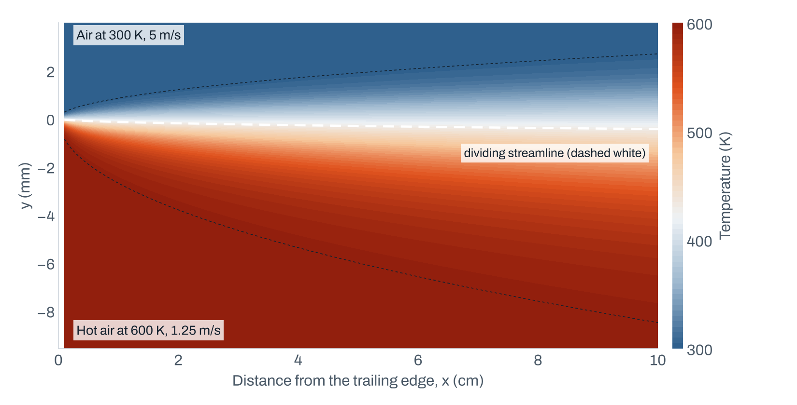
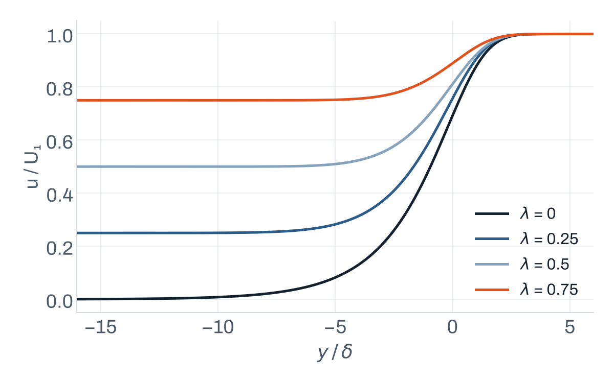
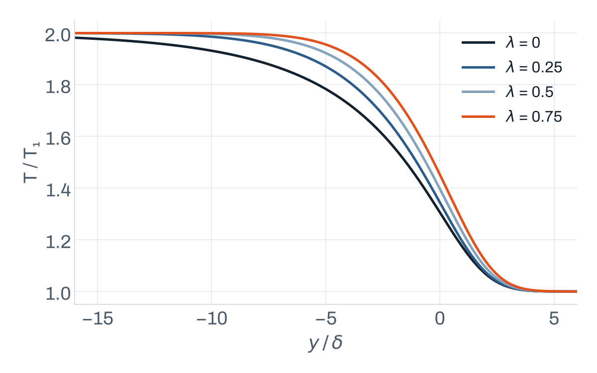
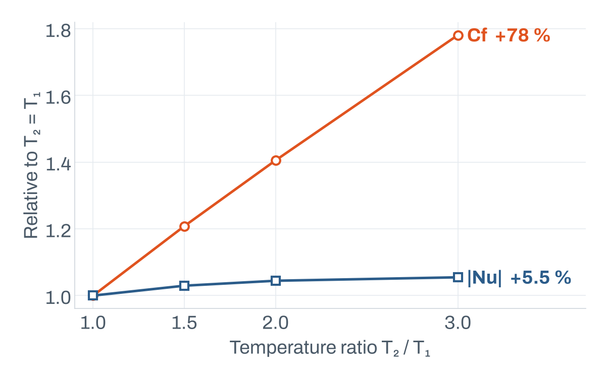

# Laminar mixing layer between a cold and a hot air stream

Similarity solutions of the 2D laminar compressible shear layer, solved in Python with a shooting method (RK4 + Newton) and validated against reference solutions.

M2 MSME fluid mechanics project (SAÉ), Université Paul Sabatier Toulouse III, 2026.



## The problem

Two parallel air streams meet behind a splitter plate. The fast stream is at T1 = 300 K, p1 = 1 bar. The slow stream moves at U2 = λ U1, with λ ∈ {0, 0.25, 0.5, 0.75}, and is chosen at T2 = 600 K, so it is half as dense. Pr = 0.5.

Assumptions: steady, laminar, thin layer, constant pressure, no viscous heating (M ≈ 0.014), Chapman–Rubesin (ρμ = ρ1μ1), constant cp and Pr.

With the Howarth–Dorodnitsyn transformation, the boundary-layer equations reduce to

- F‴ + F F″ = 0
- G‴ / Pr + F G″ = 0

with F′(+∞) = 1, F′(−∞) = λ, Ting's entrainment condition, and G′(−∞) = 0, G′(+∞) = 1. Density comes back when returning to the physical coordinate y and in the quantities that depend on ρ*.

## Method

1. **RK4.** Integrates (F, F′, F″) from η = 0 up to L_high and down to L_low.
2. **Three-parameter Newton.** Solves for (F(0), F′(0), F″(0)) so that the three far-field conditions hold to 10⁻¹⁰. The Jacobian is computed by finite differences. Continuation in λ, starting from Schlichting's values.
3. **G by superposition.** Two linear solutions and a 2 × 2 system give G′(0) and G″(0) directly.
4. **Post-processing.** Dividing streamline, vorticity thickness δω, entrainment velocities, Cf and Nu. Then the return to physical y, compressible profiles and the T(x, y) field.

## Validation

| Test | Max difference |
|---|---|
| Schlichting, λ = 0 | 2·10⁻⁴ |
| Course reference values, λ ≥ 0.25 | 1.5·10⁻³ |
| Reynolds analogy, Pr = 1 | < 10⁻⁴ |

The step study confirms that RK4 converges at order 4, and enlarging the domain changes F″(0) by less than 10⁻⁹.

## Results (T2 = 600 K)

- δω/δ and Cf increase by **35 to 46 %** compared with the constant-density case. Nu changes by only 0.3 to 4.5 %.
- With Pr = 0.5, the thermal layer is **40 to 70 % thicker** than the velocity layer.
- At x = 10 cm with U1 = 5 m/s, δω = 3.1 to 3.8 mm.
- From 300 to 900 K (λ = 0.25), Cf rises by 78 % and |Nu| by 5.5 %.

| Velocity profiles | Temperature profiles | Effect of T2 |
|---|---|---|
|  |  |  |

## Run it

```bash
pip install -r requirements.txt
python main.py
```

| Option | Run |
|---|---|
| 1 | Solve and plot F |
| 2 | Post-process F (dividing streamline, δω, entrainment, Cf) |
| 3 | Solve and plot G, and Nu |
| 4 | Compressible profiles, T(x, y) field, δω, Cf, Nu |
| 5 | Study in T2 |
| 6 | Validation against the course values and Schlichting |
| 7 | Validation with the Reynolds analogy (Pr = 1) |
| 8 | Options 1 to 4 |

Option 6 needs the course reference file `Valeurs.dat.txt`, which is not included here. All parameters are in `parametres.yaml`, and results are written to `Outputs/`.

## Files

| File | Role |
|---|---|
| `main.py` | Menu |
| `couche.py` | `CoucheCisaillement` class (RK4, Newton, superposition, post-processing) and output functions |
| `parametres.yaml` | Physical, numerical and dimensional parameters |

The code and comments are in French.

## References

- H. Schlichting, K. Gersten, *Boundary-Layer Theory*, Springer.
- L. Ting, "On the mixing of two parallel streams", *Journal of Mathematics and Physics*, 38, 153–165 (1959).

## Author

Mohamed Rayan Aissat, [portfolio](https://rayanaissat22-droid.github.io) · [LinkedIn](https://www.linkedin.com/in/mohamed-rayan-aissat-56880b337)
